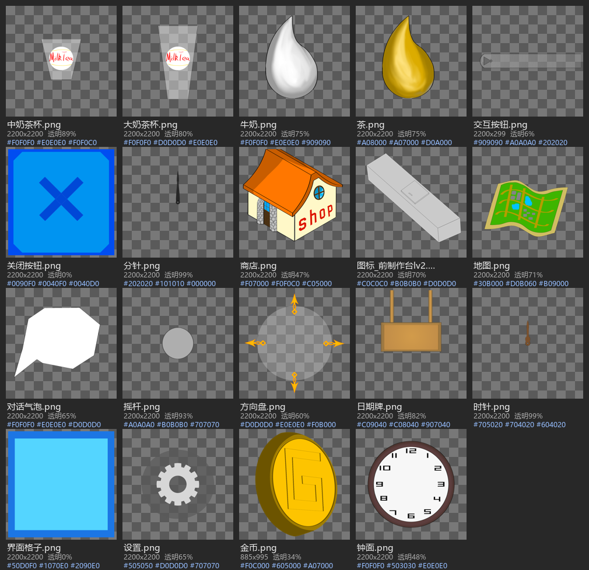
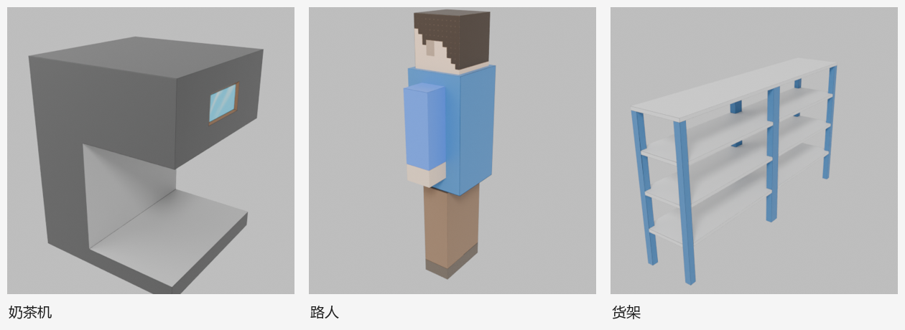
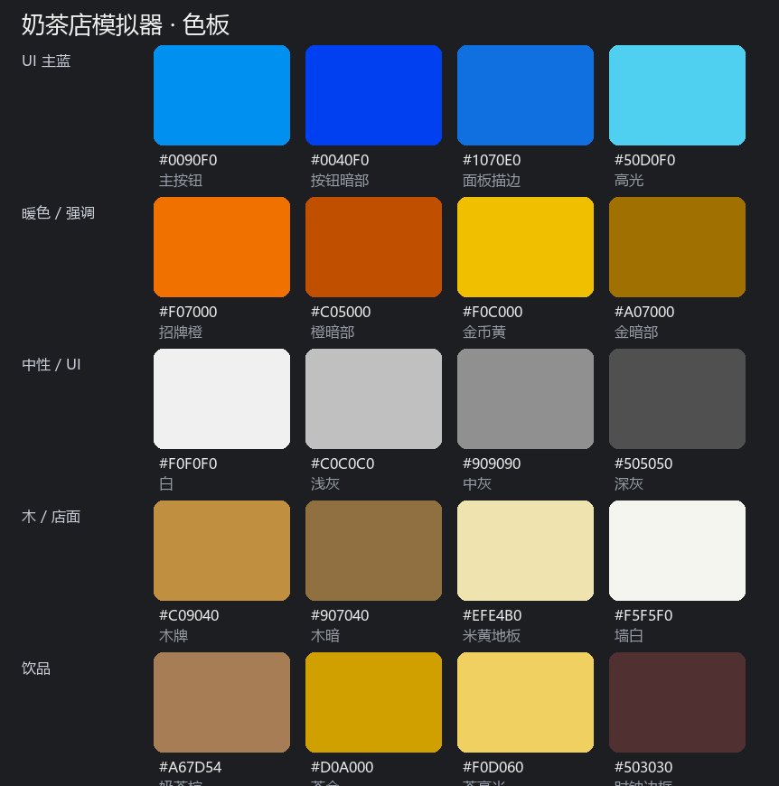

# 美术风格圣经（Art Bible）

> 2026-11-27 生成　｜　依据：对项目内 18 张 2D 贴图 + 15 个 3D 模型的实测扫描
> 配套：[美术产线方案.md](美术产线方案.md)（生产流程）、[美术参考/](../参考/美术参考/)（色板与扫描图）
> 维护规则：任何新增资产先对照本文；本文与实现冲突时，以本文为准并修实现。

---

## 0. 一句话定位

**暖光下的低模奶茶小店**：3D 世界是「方块化、纯色、无描边」的低多边形；界面是「明亮饱和、圆角、轻渐变」的休闲手游风；商品图标保留一点真实光泽。
**不是**写实、**不是**像素风、**不是**描边卡通。

| 关键词 | 含义 |
|---|---|
| 低模 Low-poly | 单件 12–1,700 三角面，形体用方盒/圆柱/简单挤压 |
| 明快 Bright | 高饱和、高明度，避免脏灰与暗部死黑 |
| 圆润 Rounded | 方盒倒角、UI 大圆角、无尖锐刺 |
| 无描边 No outline | 靠色块与光影区分，不画黑边 |
| 暖光 Warm | 室内暖黄灯光 + 深蓝环境光，形成冷暖对比 |

---

## 1. 现状扫描（实测）

### 1.1 3D 模型

| 模型 | 三角面 | 材质 | 贴图 | 造型特征 |
|---|---:|---:|---:|---|
| 加热机 | 1,692 | 1 | 90 KB | 方盒 + 圆角，灰白机身 |
| 路人 | 1,546 | 1 | 185 KB | **方块人（Minecraft 式）**，像素头发/衣服 |
| 搅拌机 | 922 | 2 | 91 KB | 圆柱 + 方座 |
| 奶茶机 | 624 | 1 | 1,161 KB | 大方盒 + 出料口，灰色 |
| 货架 | 398 | 1 | 197 KB | 白色层板 + 蓝色立柱 |
| 制冰机 | 308 | 1 | 231 KB | 方盒 + 圆角 |
| 牛奶 | 268 | 1 | 51 KB | 纸盒/瓶，白 |
| 大/中奶茶杯 | 252 | 1 | 139/183 KB | 圆台 + 杯盖，透明杯身 |
| 前制作台 | 226 | 3 | 219 KB | 台面 + 柜体 |
| 封装机 | 64 | 2 | 78 KB | 小方盒 |
| 前制作台 lv2 | 62 | 2 | 26 KB | 简化版 |
| 奶茶杯架 | 40 | 1 | 121 KB | 极简框架 |
| 前台 | 24 | 1 | 332 KB | 长条柜台（贴图为主） |
| 前制作台 lv1 | 12 | 1 | 22 KB | 极简方块 |

**结论**：全部为**单材质、低面数、贴图 ≤1.2 MB**；角色是方块人，设备是倒角方盒；没有任何 PBR 贴图组（无金属度/法线/粗糙度）。

### 1.2 2D 贴图

| 文件 | 尺寸 | 透明占比 | 主色 | 用途 |
|---|---|---:|---|---|
| 关闭按钮 | 2200² | 0% | #0090F0 / #0040F0 | 面板关闭 |
| 界面格子 | 2200² | 0% | #50D0F0 / #1070E0 | 列表格底 |
| 交互按钮 | 2200×299 | 6% | #909090 | 通用按钮条（代码染色） |
| 商店 | 2200² | 47% | #F07000 / #F0F0C0 | 商店图标（橙顶奶白墙） |
| 地图 | 2200² | 71% | #30B000 / #D0B060 | 地图图标（绿地块+土路） |
| 金币 | 885×995 | 34% | #F0C000 / #605000 | 货币图标 |
| 钟面 | 2200² | 48% | #F0F0F0 / #503030 | 时钟（白面红棕边） |
| 时针/分针 | 2200² | 99% | #705020 / #202020 | 指针 |
| 日期牌 | 2200² | 82% | #C09040 | 木牌 |
| 摇杆/方向盘 | 2200² | 93%/60% | #A0A0A0 / #F0B000 | 移动摇杆 |
| 对话气泡 | 2200² | 65% | #F0F0F0 | 顾客气泡 |
| 设置/地图/商店图标 | 2200² | 65%/71%/47% | 灰/绿/橙 | 左上角入口 |
| 中/大奶茶杯 | 2200² | 89%/80% | #F0F0F0 | 订单图标（杯） |
| 牛奶 | 2200² | 75% | #F0F0F0 渐变 | 订单图标（奶滴） |
| 茶 | 2200² | 75% | #D0A000 / #F0D060 | 订单图标（茶滴） |

**结论**：源图统一 2200×2200（按钮条 2200×299），透明底，图标均预留约 10–15% 安全边；
风格是「扁平 + 轻渐变 + 微弱高光」，**没有描边**；主色蓝、强调橙、货币金。





---

## 2. 色彩体系



### 2.1 UI 主色（蓝）

| 色值 | 名称 | 用途 |
|---|---|---|
| `#0090F0` | 主蓝 | 按钮底、面板主色 |
| `#0040F0` | 暗蓝 | 按钮暗部 / 按下态 |
| `#1070E0` | 边蓝 | 面板描边、分隔线 |
| `#50D0F0` | 高光蓝 | 渐变高光、选中态 |

### 2.2 暖色 / 强调

| 色值 | 名称 | 用途 |
|---|---|---|
| `#F07000` | 招牌橙 | 招牌、商店、重要 CTA |
| `#C05000` | 橙暗部 | 橙色阴影 |
| `#F0C000` | 金币黄 | 货币、奖励、星级 |
| `#A07000` | 金暗部 | 金币阴影 |

### 2.3 中性

| 色值 | 名称 | 用途 |
|---|---|---|
| `#F0F0F0` | 白 | 文字、高光、气泡 |
| `#C0C0C0` | 浅灰 | 禁用、次要文字 |
| `#909090` | 中灰 | 按钮底（代码染色） |
| `#505050` | 深灰 | 阴影、次要面板 |
| `#202020` | 近黑 | 正文（浅底上） |

### 2.4 材质 / 场景

| 色值 | 名称 | 用途 |
|---|---|---|
| `#C09040` | 木牌 | 日期牌、木饰 |
| `#907040` | 木暗 | 木纹阴影 |
| `#EFE4B0` | 米黄地板 | 地板 |
| `#F5F5F0` | 墙白 | 墙面 |
| `#C0C0C0` | 银灰 | 水槽、金属 |
| `#A67D54` | 奶茶棕 | 奶茶液体（α 0.8） |
| `#D0A000` / `#F0D060` | 茶金 / 茶高光 | 茶汤 |
| `#503030` | 红棕 | 时钟边框 |

**用色比例建议**：蓝 60% / 中性 25% / 暖色 15%。橙色只用于「钱、奖励、行动」，不要大面积铺。

---

## 3. 3D 世界规范

### 3.1 面数预算（硬上限）

| 类别 | 上限 | 现有参考 |
|---|---:|---|
| 小料 / 装饰小件 | 300 | 牛奶 268 |
| 杯子 | 400 | 大/中杯 252 |
| 中型设备 | 1,500 | 加热机 1,692（已超标，作为上限例外） |
| 角色 | 2,000 | 路人 1,546 |
| 大型家具 / 前台 | 800 | 前台 24、货架 398 |

> 全场景目标：≤ 8 万三角面、≤ 150 DrawCall（移动端）。

### 3.2 形体语言

- 基本体：**倒角方盒**（bevel 1–2 段）、圆柱、圆台、简单挤压
- 避免：有机曲面、布料褶皱、复杂雕花、细碎零件
- 角色：**方块人**（头/身/四肢为方盒），保持现有路人的比例（头约占身高 1/4）
- 剪影优先：远看能认出是什么，细节靠贴图而不是靠面

### 3.3 材质与贴图

- 每个模型 **1 个材质**（最多 2 个）；Standard Shader
- Metallic = 0，Smoothness = 0.1–0.3（不要塑料高光）
- 贴图 512–1024，单张；颜色块 + 轻微噪声，**不做法线/金属度/粗糙度贴图**
- 透明只允许：杯身（玻璃）、液体；其余不透明
- 颜色必须来自第 2 节色板；新增颜色先加进色板再使用

### 3.4 变换与导出

- 1 Unity 单位 = 1 米；导出前应用缩放/旋转（Scale = 1）
- 轴心：**底部中心**；朝向：**+Z**（Unity 前方）
- 导出 GLB，贴图内嵌；命名 `类型_名称_变体`
- 导入后：关闭 Read/Write（除需要改网格的），开启 Generate Colliders 仅对设备

### 3.5 光照

- 环境光：深蓝灰（场景实测 Sky `#363A42`），营造室内感
- 主光：天花板暖白点光，色温约 3500–4500K，强度 1.0–1.4，Range 10–12
- 补光：店面区域可加 1 盏低强度暖光，避免死黑
- 不做实时阴影（移动端），用贴图/顶点色假 AO

---

## 4. 2D 界面规范

### 4.1 形状

- 圆角：小控件 12 px、面板 24 px（按 2200 源图折算，实际按目标尺寸等比）
- 无描边；需要分隔时用 `#1070E0` 1–2 px 内描边或 10% 暗色
- 图标外留 10% 安全边，避免被裁

### 4.2 渐变与阴影

- 渐变方向：上亮下暗，明度差 8–15%
- 高光：左上 45° 一条柔和亮带，不画硬反光
- 投影：柔和椭圆，黑色 15–25% 透明度，偏移 2–4 px

### 4.3 按钮状态（必须三态）

| 状态 | 处理 |
|---|---|
| 常态 | 主色 + 上亮下暗渐变 |
| 按下 | 整体压暗 12%，内容下移 2 px |
| 禁用 | 去饱和 60%，透明度 50% |

### 4.4 字体与排版

- 字体：思源黑体 / 微软雅黑（Bold 用于标题，Regular 用于正文）
- 浅底用 `#202020`，深底用 `#F0F0F0`；金色文字用 `#F0C000` + 1 px `#A07000` 阴影
- 字号层级：标题 32 / 正文 22 / 辅助 16（按 1920×1080 参考）

---

## 5. 产品图标规范（订单/商店用）

现有「中/大奶茶杯、牛奶、茶」是**半写实光泽渲染**，与 UI 的扁平风不同——这是有意的分层：**世界与 UI 扁平，商品图标带光泽**。

- 尺寸：512×512 PNG，透明底
- 视角：3/4 俯视（相机俯角 20–25°），固定焦段 50 mm
- 光照：主光左上 45°、补光右侧、底部柔和接触阴影
- 内容：杯体 + 液体颜色 + 杯盖；不加文字（文字由 UI 叠）
- 一致性：所有图标共用同一相机、同一灯光、同一背景，只换液体颜色/配料

---

## 6. 命名、目录与交付

```
Assets/
  贴图/UI/            面板、按钮、图标源（2200 级）
  Resources/贴图/      运行时加载的图标（订单、货币）
  模型/设备/           奶茶机、加热机、制冰机…
  模型/道具/           杯、牛奶、小料…
ArtSource/             不参与 Unity 导入的源文件
  2D/psd, 2D/svg, 3D/blend
Docs/参考/美术参考/          色板、扫描图、渲染图
```

- 贴图：`UI_按钮_主.png`、`图标_金币.png`、`订单_大杯.png`
- 模型：`设备_奶茶机_lv2.glb`、`道具_珍珠.glb`
- 交付必须带：源文件（PSD/SVG/Blend）+ 导出图 + 一张预览图

---

## 7. Do / Don't

| ✅ Do | ❌ Don't |
|---|---|
| 倒角方盒、圆柱、圆台 | 有机曲面、布料、雕花 |
| 单材质、512–1024 贴图 | 多材质、2K/4K 贴图、PBR 套装 |
| 色板内取色 | 自创高饱和紫/青、霓虹色 |
| 无描边、靠明度区分 | 黑描边、卡通描边 |
| 暖光 + 深蓝环境 | 纯白平光、死黑阴影 |
| 图标 10% 安全边 | 内容顶到边缘 |
| 统一相机/灯光的图标 | 每个图标换角度/换光 |

---

## 8. AI 生成提示词（供 SD / Tripo 用）

**风格正向**
```
low poly stylized, casual mobile game, flat colors, clean shapes,
warm indoor lighting, soft shadows, no outline, minimal detail,
bright saturated palette, rounded boxes, cozy milk tea shop
```

**负向**
```
photorealistic, high poly, intricate detail, black outline, neon,
gothic, noisy texture, normal map, metal, glossy plastic
```

**Tripo / 图生 3D 追加**
```
single object, centered, plain white background, 3/4 view,
orthographic-ish, no text, no shadow catcher
```

> 生成后一律走「减面到预算 → 统一材质 → 按色板校色」三步，不要直接进 Unity。

---

## 9. 当前缺口（按优先级）

| 优先级 | 资产 | 数量 | 说明 |
|---|---|---|---|
| P0 | 饮品图标（新配方） | 6–8 | 512²，沿用杯/奶滴风格 |
| P0 | 小料图标（珍珠/椰果/布丁） | 3 | 可先在杯内做色块 |
| P1 | 顾客变体 | 2–3 | 换色 + 换配饰，方块人 |
| P1 | 装饰/家具 | 3–5 | 招牌、绿植、菜单板 |
| P2 | 按钮三态图 | 1 套 | 现有按钮条只有常态 |
| P2 | 面板 9-slice | 2–3 | 商店/设置/结算 |

---

## 10. 版本记录

| 日期 | 变更 |
|---|---|
| 2026-11-27 | 首版：扫描 18 张图 + 15 个模型，确定色板、面数预算、UI/图标规范 |
