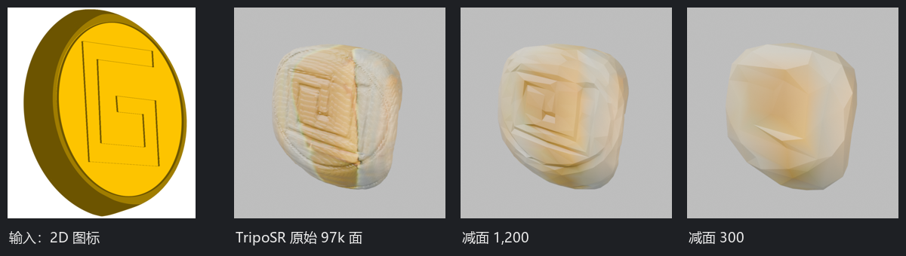

# 3D 资产管线：Tripo 图生 3D

> 2026-11-27　｜　实测环境：Windows + RTX 4070 Laptop 8GB + Node 24
> 配套：[美术风格.md](美术风格.md)（面数/材质规范）、[美术产线方案.md](美术产线方案.md)

---

## 0. 结论：你不需要去找 API Key

Tripo 现在有三条接入方式，**前两条都不用 API Key**：

| 方式 | 是否需要 Key | 适合 |
|---|---|---|
| **DSH 官方插件** | 否（浏览器授权） | 最省事，对话里直接生成 |
| **Tripo CLI** | 否（`tripo login` 浏览器授权，Key 自动落盘） | 批量、脚本化、Agent 调用 |
| **API / MCP** | 是（控制台创建） | 自建服务、接入其他客户端 |

Tripo 官方页面已列出支持 **DeepSeek Harness**（也就是你现在用的这个），装插件、登录即可，不需要 API Key。

---

## 1. 三种接入方式

### A. DSH 插件（推荐先试）

1. 在 DSH 的插件入口搜 **Tripo**（或其官方扩展）
2. 安装后点「连接」，登录 Tripo 国内站并授权
3. 新开对话，直接说「用 Tripo 生成一个 XX，给我 GLB 下载链接」

> 我这边没有直接操作 DSH 插件市场的权限，这一步需要你在界面点。

### B. CLI（本机已验证可用）

```powershell
# 登录：浏览器授权，key 自动保存，无需手动复制
npx -y tripo-cli login

# 查看账号与余额
npx -y tripo-cli whoami
npx -y tripo-cli balance

# 试运行：只打印计划，不扣积分
npx -y tripo-cli make "珍珠，圆球" --dry-run --for game-mobile --model tripo-p1
```

**实测输出**（`--for game-mobile` 会自动把面数限制到 15000、输出 FBX）：
```json
{"steps":[{"payload":{"face_limit":15000,"texture":true,"pbr":false,"model":"P1-20260311"}},
          {"name":"convert","payload":{"format":"FBX","texture_size":2048}}]}
```

### C. MCP / API

```powershell
# 本地 MCP（给支持 MCP 的客户端）
npx -y tripo-cli mcp

# 远程 MCP
# https://developers.tripo3d.com/mcp
```

自建 API：控制台 <https://developers.tripo3d.com/zh/keys> → 创建密钥（只显示一次）→
`Authorization: Bearer {api_key}` → 建议存环境变量 `TRIPO_API_KEY`，**不要提交进仓库**。

---

## 2. 模型档位与面数

| 档位 | 面数上限 | 说明 |
|---|---:|---|
| P1 | 2 万 | 最轻，适合道具/小料 |
| P2（默认） | 5 万 | 质量与面数平衡 |
| H3.1 / v3.1 | 200 万 | 高精度，不适合直接进移动端 |
| `--for game-mobile` | 15,000（预设） | 自动带减面/贴图 |

**关键**：目标资产只有 300–1,500 面，**任何档位都要再减面**。好消息是：

- 生成请求本身支持 `face_limit`（实测 P1 可传 1500）
- 平台另有「减面 / 重拓扑 / 智能 UV / 贴图 / 格式转换」后处理接口

---

## 3. 从一张图到可用低模（推荐命令）

### 3.1 输入图要求

- 单个物体、居中、纯白或透明背景
- 3/4 视角或正视图，不要多物体、不要文字
- 1024×1024 即可；有背面就补一张多视图

### 3.2 生成（参数已用 dry-run 验证）

```powershell
npx -y tripo-cli make ArtSource\2D\concepts\珍珠.png `
  --for game-mobile `
  --model tripo-p1 `
  -p face_limit=1500 `
  -p texture_size=1024 `
  --then "convert:GLTF" `
  -o ArtSource\3D\raw
```

- `--then` 会**覆盖** game-mobile 默认链（默认是 FBX 2048）
- 格式只支持 `GLTF / USDZ / FBX / OBJ / STL / 3MF`（**没有 GLB 字样**；GLTF 可导入 Unity）
- 想保留默认链就去掉 `--then`，但要接受 FBX + 2048 贴图

### 3.3 后处理（必须做）

```
原始 GLB/FBX（1–2 万面）
  → 减面到 300–1500（Blender Decimate 或 Tripo 减面接口）
  → 重 UV / 图集（Tripo 智能 UV 或 Blender）
  → 贴图降到 512–1024，删掉 PBR 贴图组（只留 BaseColor）
  → 轴心移到底部中心、应用缩放
  → 导出 GLB → 放进 ArtSource/3D/final
```

Blender 批处理示例：

```powershell
& D:\Blender\blender.exe -b -P Tools\3D\decimate_to_budget.py -- `
    --in ArtSource\3D\raw\珍珠.glb --tris 1500 --out ArtSource\3D\final\珍珠.glb
```

### 3.4 进 Unity 前检查

- [ ] 面数 ≤ spec 的 triBudget
- [ ] 材质数 = 1，贴图 ≤ 1024
- [ ] 轴心在底部中心，朝向 +Z，Scale = 1
- [ ] 无相机/灯光/空节点残留
- [ ] 命名符合 `类型_名称_变体.glb`

---

## 4. 成本

- 按积分计费，P1 最便宜，H3.1 最贵
- `--dry-run` 不扣费，可以先看计划
- `tripo balance` 查余额，`tripo usage` 看最近消耗
- 生成失败一般不扣费，但**减面/重拓扑/加贴图**是单独步骤，也会计费

---

## 5. 本地部署替代（不走 Tripo）

Tripo 的商业模型不能本地部署；可本地跑的是它的开源版 **TripoSR**。你的 8GB 显存可以：

| 方案 | 显存 | 输出 | 评价 |
|---|---:|---|---|
| **TripoSR**（开源） | ~6–8 GB | 网格 + 顶点色，无 PBR 贴图 | 秒级，适合白模/小料，不适合带贴图的杯子 |
| **Stable Fast 3D** | ~7 GB | 带贴图的网格 | 质量比 TripoSR 好，可试 |
| Hunyuan3D-2 (mini) | 8–12 GB+ | 带贴图 | 8GB 勉强，需量化 |
| TRELLIS | 16 GB+ | 带贴图 | 4070 Laptop 跑不动 |

本地路线的真实成本是**环境**：PyTorch + CUDA + 依赖，第一次配通常 1–2 小时，且模型权重几个 GB。

**建议**：先用 CLI（几秒钟出结果），本地只作为断网/免费备选。TripoSR 项目：<https://github.com/VAST-AI-Research/TripoSR>

---

## 6. 风险与对策

| 风险 | 表现 | 对策 |
|---|---|---|
| 拓扑乱 | 三角面碎片、无法动画 | 只做静态道具；角色不用 AI 生成 |
| 面数超 | 移动端掉帧 | `face_limit` + 二次减面，QA 卡预算 |
| UV 差 | 贴图拉伸、接缝 | Tripo 智能 UV 或 Blender 重 UV |
| 风格漂移 | 和现有低模不搭 | 参考图用项目内模型渲染图；生成后按色板校色 |
| 贴图过大 | 包体膨胀 | 降到 512–1024，只留 BaseColor |
| 多物体 | 一张图出多个物件 | 输入图只放一个物体，或用网格分割接口 |

---

## 7. 本地 TripoSR 实测（2026-11-27，Windows / 4070 Laptop）

> 结论先说：**能跑通，CPU 约 15 秒一个**；输出是 9.7 万面 + 顶点色、无 UV 无贴图，必须减面 + 美术 Agent 赋材质。
> 适合「白模起型」，不适合直接当成品。



### 7.1 环境

| 项 | 版本 / 说明 |
|---|---|
| Python | 3.12（独立 venv：`D:\Tools\triposr-env`） |
| GPU | RTX 4070 Laptop 8GB，驱动 596.36 |
| PyTorch | **2.14.1+cu126（GPU）**；早期为 2.15.0+cpu（官方源下载停滞，临时用 CPU） |
| transformers | 4.44.2 + tokenizers 0.19.1（4.35 在 Py3.12 上没有 tokenizers 预编译轮子） |
| 其他 | rembg[cpu] 2.0.88、trimesh 4.0.5、scikit-image、xatlas 0.0.9、moderngl 5.10.0 |
| 权重 | ModelScope `AI-ModelScope/TripoSR`：config.yaml + model.ckpt（1.6 GB） |
| DINO 主干 | ModelScope `facebook/dino-vitb16`：config/preprocessor/pytorch_model.bin（327 MB） |

> HuggingFace 直连超时、hf-mirror 的大文件 302 到被墙 CDN，所以全部走 ModelScope 下载。
> PyTorch CUDA 轮子同理：`download.pytorch.org` 实测 ~8 KB/s，改用**上海交大镜像**
> `https://mirror.sjtu.edu.cn/pytorch-wheels/cu126/`（实测 ~10 MB/s），下载后用
> `pip install --no-deps` 装本地 whl。

### 7.2 源码补丁（3 处，均在 `D:\Tools\TripoSR`）

| 文件 | 改动 | 原因 |
|---|---|---|
| `tsr/models/isosurface.py` | `torchmcubes` 导入失败时回退到 `skimage.measure.marching_cubes`，并对顶点 `np.ascontiguousarray` | torchmcubes 在 Windows 无预编译轮子、编译要 MSVC+CUDA；skimage 返回负 stride 会报错 |
| `tsr/models/tokenizers/image.py` | 本地目录走 `ViTModel.from_pretrained(path)` | 原代码只从 HF 拉 config，且不会加载 DINO 权重 |
| `run.py` | 每个输入先 `os.makedirs(output_dir/i)` | `--no-remove-bg` 时不会建子目录，导出报 FileNotFoundError |

另：`weights/config.yaml` 里 `pretrained_model_name_or_path` 改为本地 DINO 目录。

### 7.3 命令与耗时

```powershell
cd D:\Tools\TripoSR
$env:HF_HUB_OFFLINE='1'; $env:TRANSFORMERS_OFFLINE='1'
D:\Tools\triposr-env\Scripts\python.exe run.py <输入图> `
  --device cuda:0 --pretrained-model-name-or-path D:\Tools\TripoSR\weights `
  --output-dir D:\Tools\triposr-out --mc-resolution 256 --no-remove-bg
```

| 阶段 | CPU / 192 | **GPU / 256** |
|---|---:|---:|
| 加载模型 | 2.3 s | 2.9 s（含 CUDA 初始化） |
| 图像编码 + 三平面推理 | 6.2 s | **1.8 s** |
| Marching Cubes 提网格 | 6.4 s | **1.75 s** |
| 导出 OBJ | 0.2 s | 0.2–0.4 s |
| **合计** | **约 15 s** | **约 6.8 s** |

> 分辨率更高（256 vs 192）、总耗时反而减半。提网格仍走 CPU 的 skimage，但 256 下只要 1.75 s。
> 批量 15 个模型：CPU 约 12 分钟 → GPU 约 3–4 分钟。

输出：`mesh.obj`，97k–200k 三角面，带顶点色，无 UV、无贴图。

### 7.4 减面结果（用 `Tools/3D/decimate_to_budget.py`）

| 目标面数 | 视觉 | 结论 |
|---:|---|---|
| 97k（原始） | 浮雕清楚，表面噪点多、边缘圆钝 | 不可直接用 |
| 1,200 | ¥ 浮雕保留，轮廓可辨 | **可用作白模**，需重拓扑/校色 |
| 300 | 浮雕完全丢失，变成鹅卵石 | 太低，别用 |

### 7.5 经验

1. **单视角是硬伤**：3/4 渲染输入看起来更好，但模型看不到背面，结构全靠猜。
2. **TripoSR 只给白模**：顶点色勉强能看，正式资产要美术 Agent 按色板赋材质（单色 + 轻度渐变）。
3. **减面别一步到 300**：先减到 1–2k，再手工/重拓扑降到预算。
4. **CPU 够用**：15 秒/个，批量 20 个也只要 5 分钟；CUDA 可再快，但不是必需。
5. **权重放本地**：`--pretrained-model-name-or-path` 指向本地目录，配合 `HF_HUB_OFFLINE=1` 避免联网卡住。
6. **OBJ 是 Z-up**：用 Blender 导入必须 `up_axis='Z'`，否则模型躺倒（`decimate_to_budget.py` 已处理）。

### 7.6 二次测试：3/4 渲染输入（2026-11-27，见 `模型测试/`）

用项目内模型渲染的 3/4 图当输入，结果**比预期差**：

| 输入 | 原始面数 | 减面到 | 结果 | 结论 |
|---|---:|---:|---|---|
| 金币平面图标 | 97,606 | 1,200 | 圆饼 + ¥ 浮雕 | 可辨识，可当白模 |
| 货架 3/4 渲染 | 30,554 | 4,000 | 框架歪斜、薄板碎裂 | 不可用 |
| 奶茶机 3/4 渲染 | 199,372 | 3,000 | 一团块状物 | 不可用 |

**失败原因**：单视角信息不足、低模本身无细节、薄结构提不出面、输出朝向不保证。

**定位调整**：TripoSR 只用于「圆润、单件、对称」的小物件起白模（珍珠、椰果、杯子）；
设备/货架这类有薄板和内部结构的，走 **Tripo 云 P1 + face_limit** 或 Blender 参数化建模。
完整对比与复现命令见 `模型测试/README.md`。

### 7.7 全量批量：15 个模型的结论（2026-11-27）

把 `Assets/模型` 下 **15 个 GLB** 全部跑了一遍（256 分辨率、减面 3,000）：

- **只有 2 个勉强可辨**：奶茶杯_大 / 奶茶杯_中（回转体、轮廓清晰）
- 其余 13 个全部失败：设备成团块、长条家具退化成细条、货架薄板碎裂
- 结论与 7.6 一致：**TripoSR 不适合本项目的设备与家具**，不要再投入时间调参

成果与逐项评价：`模型测试/全部模型/README.md`、`总览.png`。
批量脚本：`D:\Tools\batch_tripo.ps1`（改 `$src` 可换目录）。

