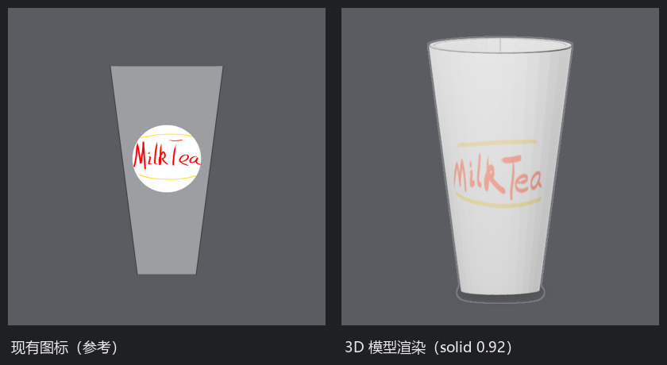

# 3D → 2D 图标 Agent 手册

> 2026-11-27　｜　专职把 3D 模型渲染成 2D 图标（订单、商店、UI）
> 配套：[美术风格.md](../02-规范/美术风格.md)、[2D美术Agent.md](2D美术Agent.md)、[数据手册.md](../03-数据/数据手册.md)

---

## 0. 为什么单独拆一个 Agent

原来的「2D-Product Agent」把「手绘图标」和「模型渲染」混在一起，两件事的工具、验收、失败模式都不一样：

| | 2D-Product（手绘/合成） | **3转2 图标 Agent（本手册）** |
|---|---|---|
| 输入 | spec + 参考图 | **3D 模型（GLB）** |
| 工具 | PIL / SVG / 外部 SD | **Blender 无头 + Cycles + Pillow 后期** |
| 风险 | 风格漂移 | 模型朝向、材质透明、接缝、比例 |
| 产出 | 插画型图标 | **与 3D 资产严格一致的图标** |

所以：**只要图标对应的东西在游戏里有 3D 模型，就走这个 Agent**，保证「图标 = 实物」。

---

## 1. 职责

- 输入：模型路径 + spec（视角、尺寸、是否描边/阴影）
- 输出：512×512 透明 PNG + 预览图 + 渲染原图
- 保证：与现有 `中奶茶杯 / 大奶茶杯 / 牛奶 / 茶` 四张参考图标同角度、同构图、同风格
- 不负责：改模型、重拓扑、画插画（这些回模型师 / 2D 美术）

---

## 2. 工具链（已实现）

| 工具 | 作用 |
|---|---|
| `Tools/Art2D/render_icon.py` | Blender 无头渲染：正交/透视、yaw/pitch、透明底、三点光 |
| `Tools/Art2D/icon_post.py` | 裁切居中、描边、接触阴影、统一 512 |

### 命令

```powershell
# 1) 渲染（原图，透明底）—— 杯子固定 yaw 180 + solid 0.92
& D:\Blender\blender.exe -b --factory-startup -P Tools\Art2D\render_icon.py -- `
    --model "Assets/模型/奶茶杯_大.glb" --out "Temp/icon_cup_raw.png" `
    --size 512 --yaw 180 --pitch 6 --samples 64 --solid 0.92

# 2) 后期（描边 + 阴影 + 居中）
& $py Tools\Art2D\icon_post.py --in Temp/icon_cup_raw.png `
    --out "ArtSource/2D/renders/大奶茶杯.png" --size 512 --outline --shadow
```

> `$py` = `C:\Users\叶尘\.dsh\dsh-runtimes\dsh-primary-runtime\dependencies\python\python.exe`

### 参数

| 参数 | 默认 | 说明 |
|---|---|---|
| `--yaw` | 0 | 水平角；**本项目杯子模型正面在 +Y，要用 180** |
| `--pitch` | 8 | 俯角；图标建议 5–8° |
| `--ortho` | 开 | 正交更扁平、更像图标；`--perspective` 可切透视 |
| `--samples` | 64 | 48 够用，透明玻璃建议 64–96 |
| `--size` | 512 | 输出边长 |
| `--solid` | 0 | **>0 时把材质压成奶白半透明**；杯子用 0.92，可同时去掉玻璃透射和背面接缝 |
| `--fill` | 0.86 | 物体占画面比例（后期） |
| `--outline` | 关 | 1–2 px 灰描边，贴近现有图标 |
| `--shadow` | 关 | 底部接触阴影 |

---

## 3. 工作流

```
模型检查（朝向/材质/接缝）
  → 渲染 raw（透明底）
  → 后期（裁切/描边/阴影）
  → 与参考图标并排比对
  → 通过 → 放入 Assets/Resources/贴图/订单/
  → 不通过 → 调 yaw/pitch/fill 或回模型师修模型
```

**模型检查三项**

1. **朝向**：先渲一张 yaw=0，看 logo 是否正向；反了就用 180（本项目的杯子就是）
2. **材质**：玻璃杯在 Cycles 里会过透，和现有「白色半透明杯」不一致 → 让模型师把杯身改成白色 0.85–0.95 不透明度
3. **接缝**：杯身中缝会渲出一条竖线（模型 UV 接缝），需要在 Blender 里合并/修线，或后期淡化

---

## 4. spec 模板

```json
{
  "id": "icon_cup_large",
  "model": "Assets/模型/奶茶杯_大.glb",
  "view": { "yaw": 180, "pitch": 6, "ortho": true },
  "size": 512,
  "fill": 0.86,
  "outline": true,
  "shadow": true,
  "output": "Assets/Resources/贴图/订单/大奶茶杯.png"
}
```

---

## 5. 验收清单

- [ ] logo / 文字**正向**，没有镜像
- [ ] 与参考图同角度（正视图，俯角 5–8°）
- [ ] 透明底，四周留白 ≥ 8%
- [ ] 描边 1–2 px、灰度 `#969BA0` 左右，不抢主体
- [ ] 接触阴影在底部、不超出画布
- [ ] 512×512，文件 < 200 KB
- [ ] 并排看时，杯型/高度/宽度比例与参考一致

---

## 6. 已知问题（2026-11-27 实测）

| 问题 | 现象 | 处理 |
|---|---|---|
| 模型正面在 +Y | yaw=0 渲出来 logo 是镜像的 | 固定用 `--yaw 180` |
| 杯身过透 | 渲染像玻璃，参考图是奶白半透明 | **已解决**：`--solid 0.92` 压成奶白 |
| 竖向接缝 | 杯身中间一条灰线 | **已解决**：solid 后不透明，背面接缝不再透出 |
| 杯型比例 | 3D 模型比手绘图标更瘦长 | 图标应服从模型；若要完全一致，调模型比例 |
| 底部椭圆 | 杯底有一圈结构线 | 正常，接近参考图的杯底 |



---

## 7. 调用模板

在本会话里说：

> 用 3转2 图标 agent 把「奶茶杯_大」渲成订单图标，按参考图风格，512 透明底

子 Agent 提示词：

```
你是 3转2 图标 Agent。先读 文档/02-规范/美术风格.md 与 文档/06-Agents/3转2图标Agent.md。
任务：把 <模型路径> 渲成 512 透明 PNG，输出到 <路径>。
要求：先用 Tools/Art2D/render_icon.py 渲染，再用 icon_post.py 后期；
与 Assets/Resources/贴图/ 下现有图标并排比对，报告角度/比例/描边是否一致。
不要改模型，不要画插画。
```
