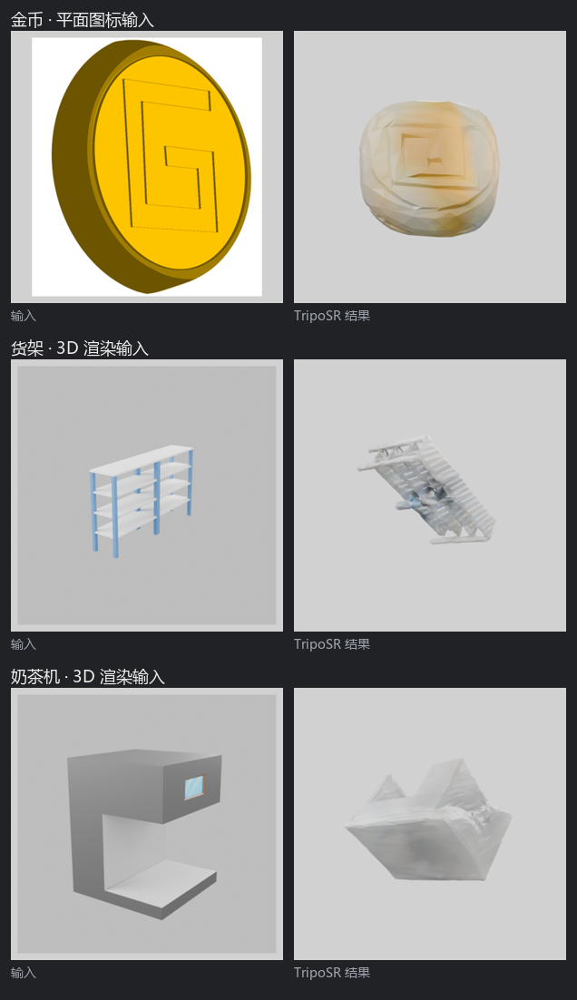

# TripoSR 模型测试

> 2026-11-27　｜　目的：验证本地 TripoSR（单图 → 3D）能否用于本项目的低模道具
> 环境：`D:\Tools\triposr-env`（Python 3.12 + torch 2.15 CPU + transformers 4.44.2）
> 权重：ModelScope `AI-ModelScope/TripoSR` + `facebook/dino-vitb16`



---

## 1. 结论（先看这里）

**TripoSR 不适合直接产出本项目的低模道具。**

- 简单、对称、单个物体（金币）→ 可以认出形状，能当白模起点
- 有薄板/框架/内部结构的物件（货架）→ 结构歪斜、薄板碎成锯齿
- 方正机械（奶茶机）→ 直接成一团，丢失所有结构

**生产建议**：道具/设备继续用 **Tripo 云端 P1 + `face_limit`** 或 Blender 参数化建模；
TripoSR 只用来给「圆润、单件、对称」的小物件起白模（如珍珠、椰果、杯子）。

---

## 2. 三次测试

| # | 输入 | 原始面数 | 减面到 | 结果 | 评价 |
|---|---|---:|---:|---|---|
| 01 | 金币平面图标（2200²） | 97,606 | 1,200 | 圆饼 + ¥ 浮雕，边缘圆钝 | 可辨识，可当白模 |
| 02 | 货架 3/4 渲染（512² 灰底） | 30,554 | 4,000 | 框架歪斜、薄板碎裂 | 不可用 |
| 03 | 奶茶机 3/4 渲染（512² 灰底） | 199,372 | 3,000 | 一团块状物 | 不可用 |

耗时（CPU，`--mc-resolution 192/256`）：

| 测试 | 加载 | 推理 | 提网格 | 导出 | 备注 |
|---|---:|---:|---:|---:|---|
| 金币 | 2.3s | 6.2s | 6.4s | 0.2s | 192 |
| 货架 | 2.3s | 6.3s | 6.4s | 0.1s | 192 |
| 奶茶机 | 2.3s | 6.1s | 14.4s | 0.4s | 256 |

---

## 3. 为什么效果差

1. **单视角信息不足**：3/4 渲染看不到背面，模型只能猜体积，内部结构全靠脑补。
2. **低模本身没有细节**：输入只有 24–1,692 面、纯色块，TripoSR 学到的是「大色块 → 平滑团块」。
3. **薄结构是死穴**：货架的层板只有 1–2 面厚，marching cubes 提不出干净薄片。
4. **朝向不保证**：货架结果整体是斜的，说明它没有稳定的上方向；需要手动对齐。
5. **减面会杀结构**：1,200 面以下，浮雕和薄板都会消失。

---

## 4. 复现

```powershell
# 1) 渲染输入（3/4 视角、灰底）
& D:\Blender\blender.exe -b -P Tools\3D\render_views.py -- `
  --model "Assets/模型/货架.glb" --out-dir Temp\shelf_input --views 35 `
  --size 512 --pitch 18 --perspective --bg 0.82 --prefix input

# 2) TripoSR 生成
cd D:\Tools\TripoSR
$env:HF_HUB_OFFLINE='1'; $env:TRANSFORMERS_OFFLINE='1'
D:\Tools\triposr-env\Scripts\python.exe run.py <输入图> --device cpu `
  --pretrained-model-name-or-path D:\Tools\TripoSR\weights `
  --output-dir Temp\tripo_out --mc-resolution 192 --no-remove-bg

# 3) 减面（OBJ 为 Z-up，脚本已处理）
& D:\Blender\blender.exe -b -P Tools\3D\decimate_to_budget.py -- `
  --in Temp\tripo_out\0\mesh.obj --tris 4000 --out 模型测试\02_货架\结果.glb
```

---

## 5. 文件说明

```
模型测试/
  总览.png          三组对比（输入 vs 结果）
  01_金币/           输入.png  结果.glb  预览.png
  02_货架/           输入.png  结果.glb  预览_35/125/215.png
  03_奶茶机/         输入.png  结果.glb  预览_35/125/215.png
```

GLB 可直接拖进 Blender 查看；未导入 Unity（避免污染工程资源）。

---

## 6. 如果还要继续用 TripoSR

提高成功率的做法，按性价比排序：

1. **换多视角**：TripoSR 是单图模型，多视角没用；改用 Tripo 云的多视图生成。
2. **只做圆润单件**：珍珠、椰果、布丁、杯子这类，成功率明显高。
3. **提高分辨率**：`--mc-resolution 256`，但面数会翻倍（20 万 → 减面压力更大）。
4. **先修输入图**：白底、物体占画面 80%、正交视角、不要阴影和背景道具。
5. **接受「白模」定位**：拿它起型，后面手工重拓扑 + 贴图，不要指望直接可用。
