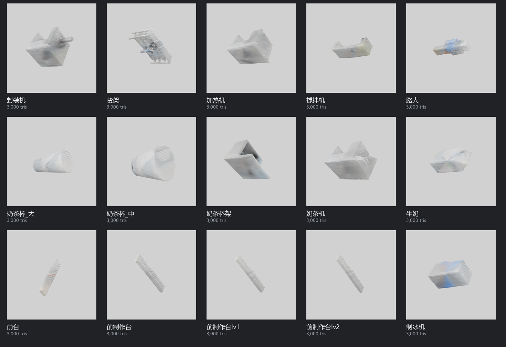

# 全部模型 · TripoSR 批量重建

> 2026-11-27　｜　对项目内 **15 个 GLB** 全部跑一遍：3/4 渲染输入 → TripoSR(256) → 减面 3,000 → 结果渲染
> 参数比上一轮更「重」：`--mc-resolution 256`、减面 3,000（上一轮 192 / 1,200）



---

## 结论

**15 个里只有 2 个勉强能认出形状（两种杯子），其余全部不可用。**

| 模型 | 结果 | 评价 |
|---|---|---|
| 奶茶杯_大 | 杯形可辨，杯口/杯身清楚 | ⚠️ 可当白模，需重拓扑 |
| 奶茶杯_中 | 杯形可辨，略歪 | ⚠️ 同上 |
| 封装机 | 团块 + 一根凸起 | ❌ |
| 货架 | 倾斜框架、薄板锯齿 | ❌ |
| 加热机 | 团块，顶部起伏 | ❌ |
| 搅拌机 | 扁团块 | ❌ |
| 路人 | 小团块，颜色串色 | ❌ |
| 奶茶杯架 | 空心块，结构丢失 | ❌ |
| 奶茶机 | 团块，开口塌陷 | ❌ |
| 牛奶 | 扁团块 | ❌ |
| 前台 | 细长条 | ❌ |
| 前制作台 | 细长条 | ❌ |
| 前制作台lv1 | 细长条 | ❌ |
| 前制作台lv2 | 细长条 | ❌ |
| 制冰机 | 团块 | ❌ |

---

## 为什么全部失败

1. **输入是「低模 + 纯色」**：模型本身没有表面细节，TripoSR 只能拟合出大团块。
2. **单视角**：3/4 渲染看不到背面与内部，柜体、开口、层板全靠猜。
3. **薄/长结构**：前台、前制作台这种「长条 + 薄板」，marching cubes 直接退化成一根条。
4. **杯子能成功**：因为杯子是回转体、单件、轮廓清晰，正好是 TripoSR 的舒适区。

---

## 建议

- **不要再拿 TripoSR 跑设备**：试了两轮（192 与 256），结论一致，投入产出比很低。
- 设备/家具：继续用 Blender 参数化建模，或用 **Tripo 云端 P1 + `face_limit=1500`**（有多视图与减面接口）。
- TripoSR 只保留给「圆润、单件、对称」的小物件（珍珠、椰果、布丁）。

---

## 文件

```
全部模型/
  总览.png
  <模型名>/
    input/input_035.png    输入的 3/4 渲染
    raw/0/mesh.obj         TripoSR 原始网格（20 万面左右）
    preview/res_035.png    结果渲染
    结果.glb               减面到 3,000 的成品
```

复跑脚本：`D:\Tools\batch_tripo.ps1`（改 `$src` 可换目录）。
